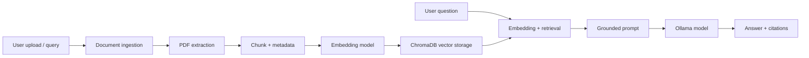

# College Knowledge Assistant using RAG

This project is a local, document-grounded academic assistant for college knowledge. It allows users to upload PDF materials, retrieve relevant passages, and ask questions using a selected LLM model from Ollama.

## Overview

The system is designed for a beginner-friendly but maintainable RAG pipeline. It uses:

- Streamlit as the interface
- PDF extraction with PyMuPDF
- ChromaDB for local vector storage
- Sentence Transformers for embeddings
- Ollama for local inference
- Python service modules for ingestion, retrieval, and answer generation

## Features

- PDF upload and validation
- Chunking with metadata retention
- Local vector search and retrieval
- Grounded model prompting with source citations
- Clear abstention when evidence is missing
- Model selection from locally installed Ollama models
- Dashboard, document library, and settings screens
- Minimal test coverage for the retrieval and ingestion pipeline

## Architecture



## Tech stack

- Python 3.14-compatible environment where dependencies support it
- Streamlit
- PyMuPDF
- ChromaDB
- SentenceTransformers
- Ollama
- pytest

## Prerequisites

- Python 3.14 or a compatible Python 3.12/3.13 environment if a dependency is blocked
- Ollama running locally
- At least one model installed, typically `qwen2.5:3b`

## Installation

```powershell
py -0p
python -m venv .venv
.\.venv\Scripts\Activate.ps1
python -m pip install --upgrade pip
python -m pip install -r requirements.txt
```

If PowerShell blocks activation, use:

```powershell
Set-ExecutionPolicy -Scope Process -ExecutionPolicy Bypass
.\.venv\Scripts\Activate.ps1
```

## Local model setup

```powershell
ollama list
ollama run qwen2.5:3b
```

If `qwen2.5:3b` is not available, the application will display a clear model error and ask you to install it or select a different local model.

## Run the app

```powershell
streamlit run app.py
```

## How it works

1. Upload a PDF document.
2. Text is extracted and chunked.
3. Each chunk is stored with metadata in ChromaDB.
4. A user question is embedded and matched against the stored chunks.
5. The most relevant context is sent to the selected Ollama model.
6. The final answer cites only the retrieved sources.

## Citation behavior

The system only cites passages that were actually retrieved for the answer. If a supporting fact is not found in the uploaded documents, the answer clearly states that the requested information was not present in the available knowledge base.

## Tests

```powershell
python -m pytest -q
```

## Privacy and security notes

- Private documents should stay local to the project workspace.
- Public-source PDFs are recommended for demonstration.
- Secrets should live in `.env` and should not be committed.
- The prototype is designed for local academic use and does not replace a production-grade multi-user authorization model.

## Troubleshooting

- If Ollama is not running: start it and confirm `ollama list` works.
- If the selected model is unavailable: install it or choose another detected model.
- If the PDF has no extractable text: try a text-based PDF or add OCR support later.
- If embedding fails: check the local Python environment and package compatibility.

## Future enhancements

- PDF OCR for scanned documents
- Document metadata UI and filters
- Hybrid retrieval and reranking
- Conversation persistence in SQLite
- FastAPI backend for a separate API layer
- Better evaluation metrics for retrieval quality
